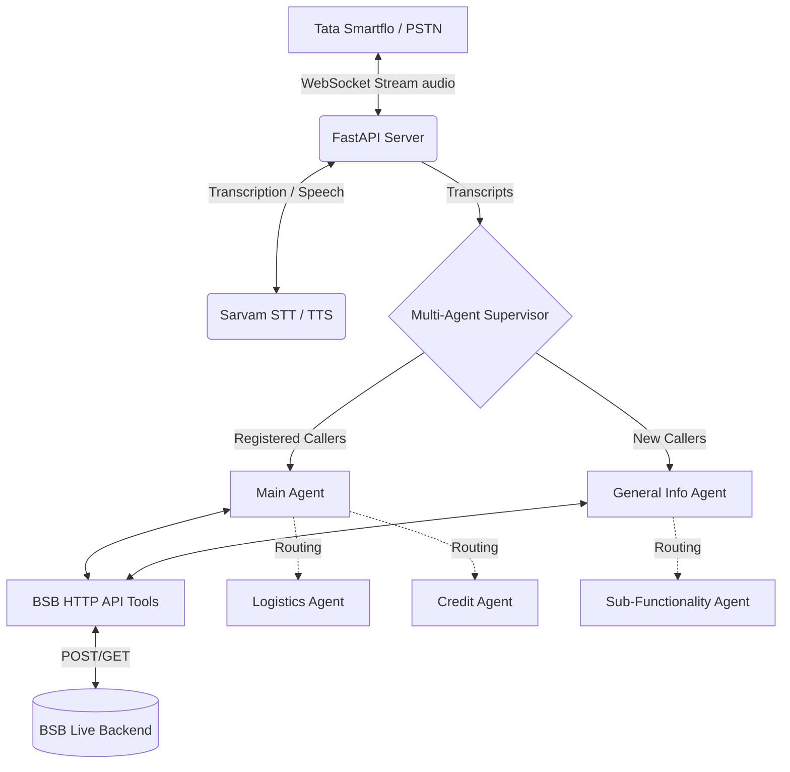

# BSB Polymer Voice AI Agent

An enterprise-grade, multi-agent voice AI orchestrator for **BSB Fortrade Private Limited** — India's tech-driven polymer distribution platform based in Ahmedabad, Gujarat.

## Overview

This project implements **Neha**, a highly intelligent, conversational AI voice agent that acts as a Lead Capture Specialist. The system handles inbound and outbound customer calls for BSB Polymer via a real-time WebSocket stream connected directly to Tata Smartflo IVR.

The system utilizes a **LangGraph Multi-Agent Architecture** to intuitively route conversations to specialized sub-agents based on the user's intent.

### Core Capabilities
- **Human-like Interaction:** Speaks in natural Hindi/Hinglish using female grammar and conversational fillers.
- **Lead Capture Flow:** Dynamically guides callers through a strict lead qualification process (Name → Role → Material → Brand → Quantity → Location).
- **Live HTTP API Integration:** Fetches live dispatch prices, checks existing registered buyer history, and saves enquiry data directly to the BSB live backend.
- **Automated WhatsApp Follow-ups:** Triggers the BSB WhatsApp API directly to dispatch the BSB Polymer App link.
- **Specialized Routing (Multi-Agent):** Can seamlessly hand off conversations internally to Logstics, Credit, or Knowledge specialized agents.

---

## 🏗️ System Architecture



### Tech Stack

| Component | Technology |
|-----------|------------|
| **Framework** | FastAPI (Python) |
| **Agent Engine** | LangChain / LangGraph |
| **LLM Inference** | Groq (`llama-3.3-70b-versatile`) |
| **Speech Services** | Sarvam AI (Custom STT / TTS) |
| **Database/State** | SQLite + SQLAlchemy (Checkpointers & CRM) |
| **HTTP Interfacing**| LangChain `@tool` wrapped Requests |
| **Tunneling** | ngrok |

---

## 📂 Project Structure

```
Project/
├── app/
│   ├── agents/
│   │   ├── graph.py               # LangGraph state machine builder
│   │   ├── supervisor.py          # Entry node router
│   │   ├── main_agent.py          # Neha script (Registered Callers)
│   │   ├── general_info_agent.py  # Neha script (New Callers)
│   │   ├── logistics_agent.py     # Sub-agent: Freight & Trucking
│   │   ├── credit_agent.py        # Sub-agent: NBFC & Financing
│   │   ├── sub_functionality_agent.py # Sub-agent: Deep BSB knowledge
│   │   ├── session_store.py       # Interacts with DB for conversation tracking
│   │   └── tools/
│   │       ├── bsb_http_tools.py  # Connects directly to BSB Live APIs
│   │       ├── crm_tools.py       
│   │       ├── knowledge_tools.py 
│   │       ├── logistics_tools.py 
│   │       └── credit_tools.py    
│   ├── api/
│   │   ├── streams.py             # Active Tata Smartflo WebSocket handler
│   │   ├── endpoints.py           # Standard REST endpoints
│   │   └── webhooks.py            # Async Webhooks
│   ├── core/
│   │   ├── config.py              # Environment variables & API URL mappings
│   │   ├── database.py            
│   │   └── models.py              # ConversationSession SQLAlchemy models
│   ├── services/
│   │   ├── multi_agent_orchestrator.py # Bridge between streams.py & LangGraph
│   │   └── sarvam_service.py      # Indian-accent TTS/STT via Sarvam AI
│   └── main.py                    # Application Entrypoint
├── .env                           # Secrets & keys
├── requirements.txt               # Dependencies
└── README.md                      # Documentation
```

---

## 🛠️ API Tool Integrations (`bsb_http_tools.py`)

The agents heavily rely on real-time integrations with the BSB Infrastructure:

1. **Buyer Details API (`/api/web/get-buyer-lead`)**
   - Automatically executed at absolute start of call to bypass asking for details already stored under the caller's phone number.
2. **Get Price API (`/api/web/seller-offer-list`)**
   - Triggered when the user asks for rates. Queries by grade, brand, and code to return formatted responses specifying material location.
3. **Save Enquiry API (`/api/web/save-buyer-lead`)**
   - Logs the summarized, confirmed quote and location agreement with the caller directly onto the BSB Platform.
4. **WhatsApp Dispatch API (`/api/v2/messages/template`)**
   - Dispatches a video header alongside the BSB Polymer App link immediately following a successful backend save.

---

## 🚀 Getting Started

### Prerequisites
- Python 3.9+
- Activated API Keys for: **Groq**, **Sarvam AI**, **Deepgram** *(Legacy fallback)*
- `ngrok` account for tunneling the WebSocket API to Tata Smartflo.

### Setup Instructions

1. **Clone the repository:**
   ```bash
   cd Desktop/Project
   ```

2. **Setup your environment:**
   Create `.env` based on `app/core/config.py`:
   ```env
   GROQ_API_KEY=your_groq_api_key
   SARVAM_API_KEY=your_sarvam_api_key
   ```

3. **Install dependencies:**
   ```bash
   pip install -r requirements.txt
   ```

4. **Initialize Backend:**
   The SQLite databases (`conversations.db` and LangGraph's checkpointer `conversations_graph.db`) will auto-generate upon successful startup.

5. **Start Application:**
   ```bash
   uvicorn app.main:app --host 0.0.0.0 --port 8000 --reload
   ```

6. **Start ngrok Tunnel:**
   Expose port 8000 to acquire your wss:// endpoint for Tata Smartflo.
   ```bash
   ngrok http 8000
   ```
   **Tata Webhook Endpoint:** `wss://<ngrok-url>/ws/tata-audio`

---

## 📞 Endpoints

### `GET /agents/status`
Debug endpoint displaying the last 20 active LangGraph conversation sessions, showing node handoffs, session stages, and collected customer CRM intel.

### `WS /ws/tata-audio`
Primary audio ingestion gateway. Bi-directional WebSocket receiving PCM/µ-law audio from Tata, processing it via Sarvam STT, piping through the LangGraph agents, and returning Sarvam TTS frames interactively.

---

## 📝 License
Proprietary - BSB Fortrade Private Limited
